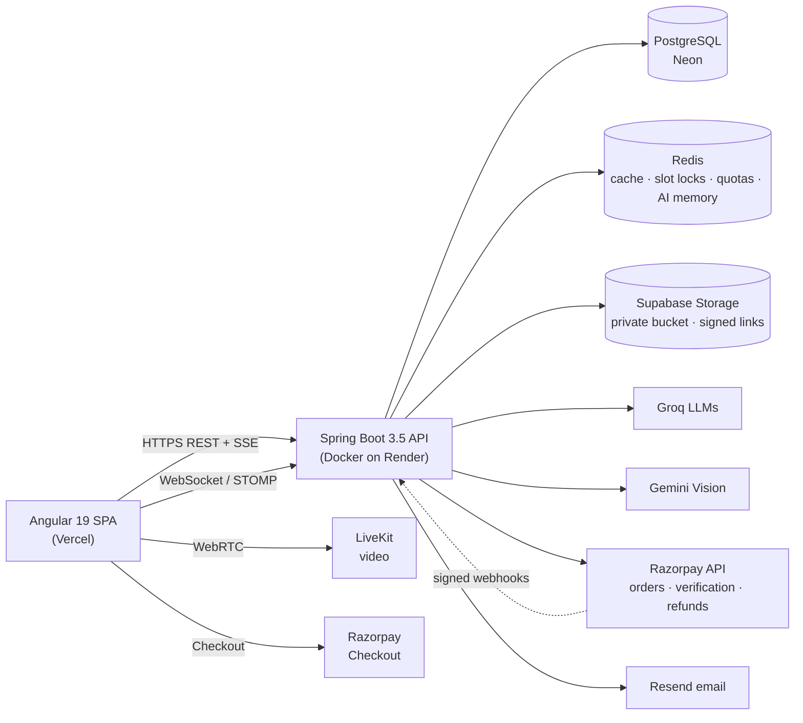
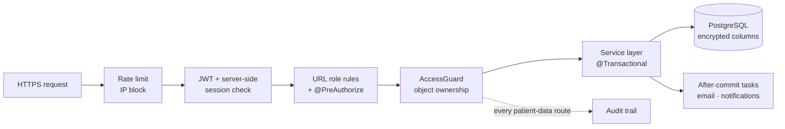
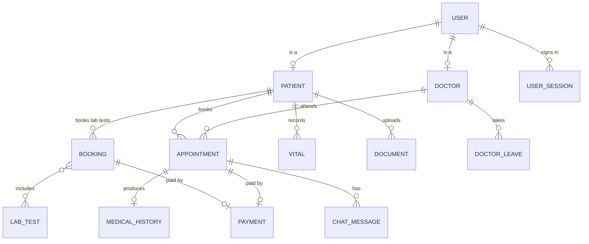
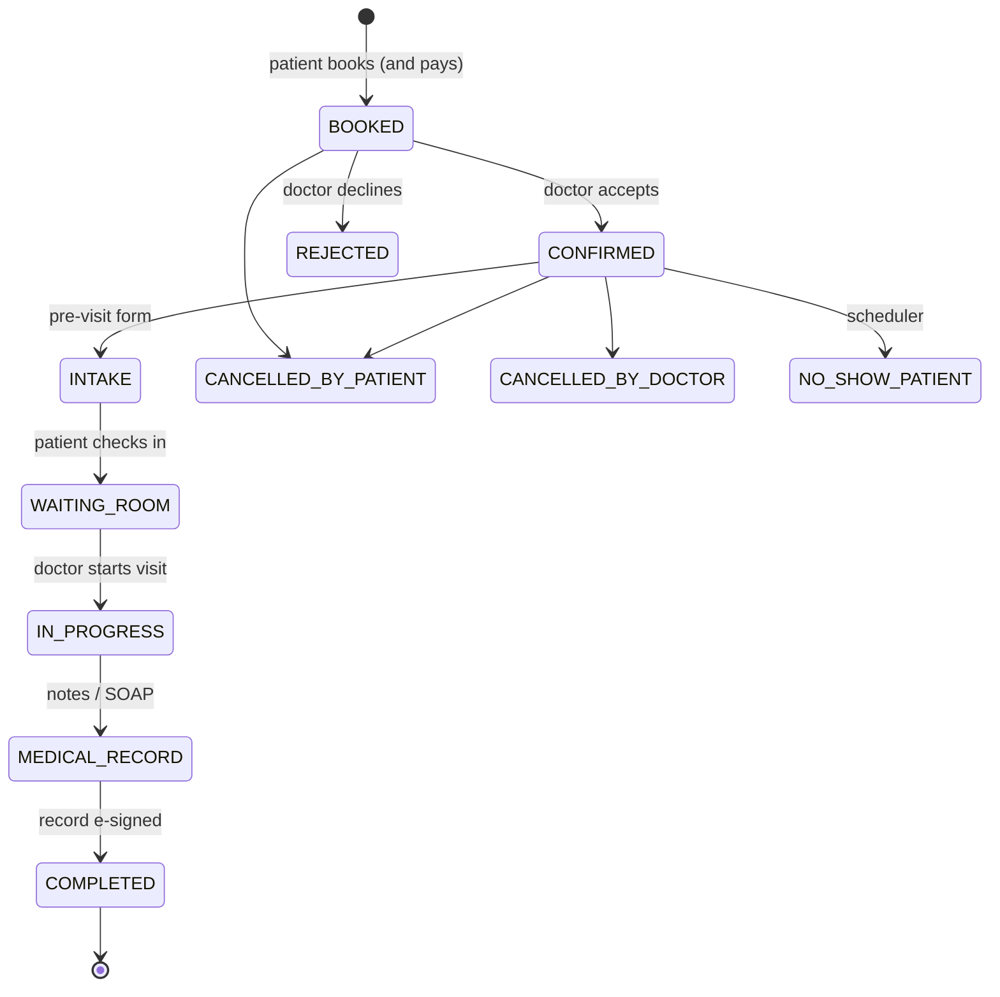
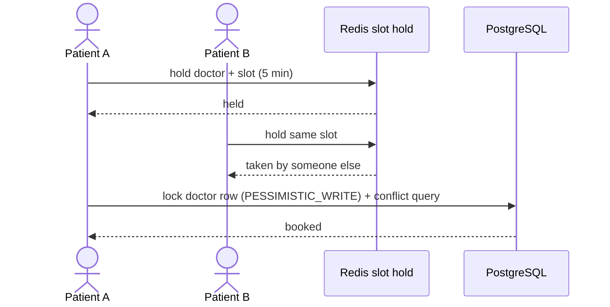
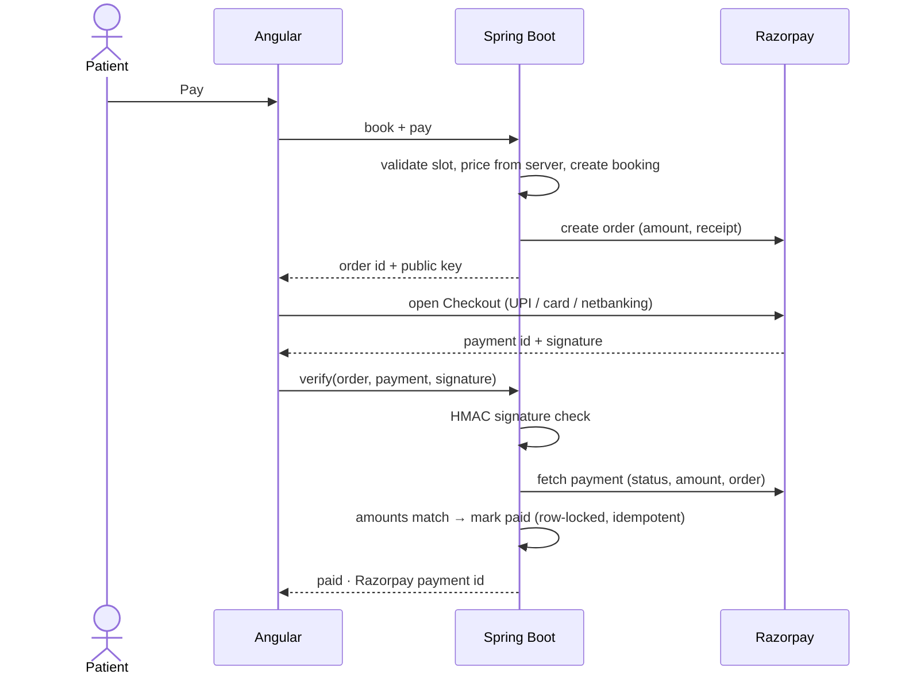
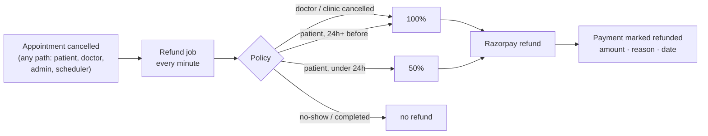
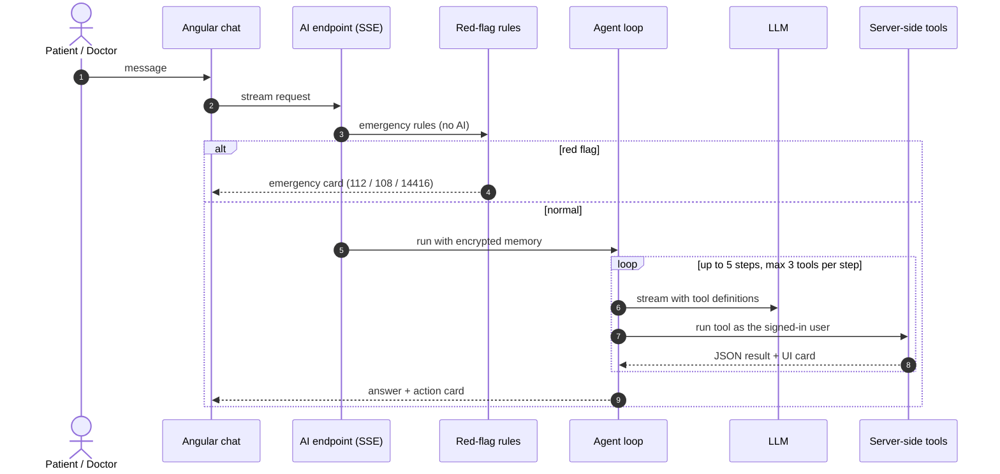

# CareSync: Technical Overview

CareSync is a telehealth platform for patients, doctors and admins: appointment booking with online payment, video consultations, medical records, lab tests, and an AI assistant woven into every journey. This page explains **what it is built with, how it works and how it is secured**, for reviewers who want to understand the engineering without reading the source.

> **Live app:** [caresync-vikrant.vercel.app](https://caresync-vikrant.vercel.app/) · Built and maintained by **Vikrant Chauhan** · Source code is private; a walkthrough is available on request.

---

## At a glance

| | |
|---|---|
| **Users** | Patients, doctors (verified by an admin), admins |
| **Backend** | Java 21 · Spring Boot 3.5 · Spring Security · Spring Data JPA · WebSocket (STOMP) |
| **Frontend** | Angular 19 (standalone components, signals) · Tailwind CSS · RxJS |
| **Data** | PostgreSQL (Neon) with 19 Flyway migrations · Redis for cache, locks, quotas and AI memory |
| **AI** | Groq (gpt-oss-120b / 20b) for agents and summaries · Gemini 2.5 Flash for documents and images |
| **Integrations** | Razorpay payments · LiveKit video · Supabase Storage (private bucket) · Resend email · Google sign-in |
| **Hosting** | Backend in Docker on Render · Frontend on Vercel · Database on Neon |
| **Size** | 25 REST controllers · 30 JPA entities · 33 repositories · 79 service classes · 58 test classes |

---

## 1. Product: who uses it and what they can do

**Patients**
- Find doctors by specialization or by describing symptoms; book a slot and pay online (UPI, card, netbanking).
- Book by chatting with an AI agent ("a skin doctor tomorrow after 5 pm"); the AI prepares, the patient confirms.
- Video consultation, pre-visit intake form, after-visit summary, prescriptions and medical history.
- Lab test booking, lab report explainer, vitals tracking, payment history with receipts and refunds.
- Data export (including a FHIR export) and saved-chat management.

**Doctors**
- Schedule, leave management, appointment workflow from intake to signed record.
- Voice dictation to SOAP notes, AI clinical co-pilot with citations, next-patient brief.
- E-signed medical records, lab test management, earnings dashboard (display only).

**Admins**
- Doctor verification (with AI certificate check), users, appointments, lab catalogue, master data.
- Security console (sessions, IP blocks), appointment analytics, finance dashboard (revenue, refunds, failures).

---

## 2. High-level design (HLD)

### System architecture

### Main building blocks

| Component | Responsibility |
|---|---|
| **Angular SPA** | Three role-specific layouts (patient, doctor, admin) in one lazy-loaded app; route guards; JWT interceptor with silent refresh |
| **REST API** | Stateless request handling behind Spring Security; OpenAPI documented |
| **Real-time** | STOMP over WebSocket for consultation chat and notifications; Server-Sent Events for streaming AI replies; LiveKit for video |
| **PostgreSQL** | System of record. Schema owned by Flyway; Hibernate only validates it |
| **Redis** | Cache (with graceful bypass when Redis is down), slot holds, rate-limit and AI quota counters, encrypted AI chat memory |
| **Scheduled jobs** | Reminders, no-show handling, retention, payment reconciliation and refunds; each runs once across instances via PostgreSQL advisory locks |
| **AI layer** | Agent loop with tool calling, model routing and fallback, guardrails, audit |

### How a request travels

### Deployment

- **Backend:** multi-stage Docker image running as a non-root user on Render. Flyway migrates the database on startup; the app refuses to start if the schema and entities disagree.
- **Frontend:** static build on Vercel with strict security headers (Content-Security-Policy, HSTS, frame and referrer policies).
- **Configuration:** every secret comes from environment variables; none are stored in code or logs.
- **CI:** GitHub Actions builds and runs the full test suite on every push, plus static analysis.

---

## 3. Low-level design (LLD)

### Backend structure

A classic layered design, with security as a cross-cutting layer rather than code inside each endpoint.

| Layer | What lives there |
|---|---|
| `controller` | REST endpoints, request validation (`@Valid`), method security (`@PreAuthorize`) |
| `service` | Business rules and transactions; AI agents and tools; payment, refund and finance services |
| `repository` | Spring Data JPA repositories; pessimistic-lock queries for contested rows |
| `entity` | JPA entities; sensitive columns encrypted through an attribute converter |
| `security` | JWT and session handling, `AccessGuard`, audit trail, encryption, rate limiting, WebSocket authentication |
| `scheduler` | Cron jobs guarded by a cluster-wide lock |
| `event` / `listener` | Domain events (booked, checked in, visit started, report signed, no-show) |

### Core domain model

Patients and doctors share the user's primary key (`@MapsId`), so one id identifies a person across tables, and authorization checks compare ids, never names.

### Appointment lifecycle

Every transition is validated against the current state and the actor's role, and recorded in a status history log.

Rules worth noting: a visit can only be completed once its medical record is e-signed; patients can only act before the visit is accepted; doctors cannot cancel a visit that has started.

### Booking without double-booking

Bookings must land on the doctor's real slot grid, within a 90-day horizon, with per-patient caps (one upcoming visit per doctor, five overall) and one slot hold at a time. This blocks slot-hoarding as well as races.

### Payments: Razorpay checkout

The browser never decides that a payment succeeded; the server confirms it with Razorpay.

- **Prices come from the server** (doctor fee, lab test total); a request cannot change the amount.
- **Idempotent:** payment rows are locked during confirmation; repeated callbacks are ignored.
- **Abandoned checkouts:** closing Checkout cancels the order and frees the slot; a reconcile job settles or cancels anything left pending after 20 minutes, and refunds a payment that arrives after its booking was released.
- **Webhooks** (optional) are verified with an HMAC of the raw body, and the payment is re-fetched from Razorpay instead of trusting the body.
- **Demo mode** keeps the full flow usable without a gateway, clearly labelled, and controlled by a server setting.

### Refunds and finance

- The job catches every cancellation path, so new features cannot forget to refund. Each refund runs in its own transaction and is retried if the gateway fails.
- The cancel dialog shows the exact refund before the patient confirms, computed by the same policy code.
- **Admin finance:** gross, refunds and net revenue by day and month, failed payments, abandoned checkouts.
- **Doctor earnings:** what each doctor's visits earned after refunds (display only; no money is routed to doctors, which would require a licensed split-payment product).

### Reliability patterns

| Problem | Solution |
|---|---|
| Emails sent for bookings that later rolled back | After-commit dispatcher: side effects run only after the database commit |
| Two app instances running the same cron job | PostgreSQL advisory lock per job |
| Redis outage | Cache errors bypass to the database; limits and AI memory fall back gracefully |
| Bursts of payment gateway calls | Fair semaphore around gateway calls |
| Schema drift | Flyway owns the schema; Hibernate in validate mode; each migration ships with a rollback script and notes on lock risk |
| AI provider down or rate-limited | Model fallback chain, then recorded facts; booking still works with buttons |

---

## 4. The AI layer

AI is part of every journey, but it never acts alone: it **prepares**, a human **confirms**.

- **Patient agent (10 tools):** search doctors, check slots, prepare booking / cancel / reschedule, list appointments, lab tests. `prepare_*` tools only return a confirmation card; nothing changes until the patient presses Confirm.
- **Doctor co-pilot (7 read-only tools):** every call re-checks that the patient is the doctor's own; only minimum data reaches the model (no phone, email, address or date of birth); answers cite their source.
- **Two-layer triage:** deterministic red-flag rules (including negation and Hindi) run before any AI.
- **Model routing:** large model for agents, small model for summaries, vision model for files, with automatic fallback.
- **Guardrails and cost:** per-user quotas (20/min, 200/day), input limits, encrypted response cache, prompt-injection handling (tool output is data, not instructions), full audit of every AI call (model, tokens, latency, tools), AI text encrypted and expired.

---

## 5. Security

Health data needs defence in depth. Each layer assumes the one before it might fail.

### Authentication and sessions
- Short-lived JWT access tokens plus rotating refresh tokens, **both bound to a server-side session**, so logout, password change and admin revocation take effect immediately.
- Sessions end after 1 hour idle or 24 hours total; users can see and sign out their other devices; changing a password signs out every other device.
- Email ownership verified by OTP; Google sign-in only takes over an existing account whose email was verified, otherwise it claims it safely (new password, all sessions ended).
- Admin sign-in requires a second factor (one-time code by email). OTP attempts are limited per account, not just per IP.

### Authorization in three layers
1. **URL rules** per role in Spring Security.
2. **Method security** (`@PreAuthorize`) on every controller method.
3. **Object-level `AccessGuard`:** a patient sees only their own records; a doctor sees a patient only while treating them; unknown ids are denied exactly like forbidden ones (no existence leaks). Identity is always resolved by user id, never by a case-insensitive name match.

Additional rules: unsigned draft records are visible only to their author; only the author (or an admin) can edit or delete a record; lab catalogue changes require a verified doctor.

### Data protection
- **Encryption at rest:** patient-data columns use AES-256-GCM with a random IV per value (tamper-evident). Redis values and AI texts are encrypted too.
- **Files** live in a private bucket and open only through short-lived signed links or an authenticated endpoint that re-checks access.
- **Audit trail:** every request to a patient-data route is recorded (route template, record ids, status, user, IP), including refused ones. Bodies, query strings and free text are never logged. Paths are normalised before matching, so encoded URLs cannot skip auditing.
- **Privacy operations:** retention jobs, patient data export, signed records that cannot be overwritten.

### Transport and browser
- HTTPS everywhere; strict Content-Security-Policy (only own scripts plus named providers), HSTS, `X-Frame-Options`, `nosniff`, referrer and permissions policies.
- WebSocket connections are authenticated on connect and **re-validated on every frame**, so a revoked session cannot keep listening.

### Abuse protection
- Per-IP rate limiting (token bucket) and IP blocking; AI quotas; booking caps and slot-hold limits.

### Payments
- No card or UPI data ever touches CareSync servers (Razorpay Checkout collects it); amounts are server-priced; signatures and payment state are verified with Razorpay.

### Security review
In 2026 I ran a structured security review of the platform covering authentication, object-level access (IDOR), injection, health-data exposure, secrets, encryption and headers, dependencies, retention and rate limiting. **All 18 confirmed findings (4 high, 5 medium, 9 low) were fixed**, most with regression tests. Examples of what was hardened:
- account linking on Google sign-in now requires a verified email;
- usernames are case-insensitively unique and roles are resolved by id;
- medical records are bound to their appointment's patient and doctor;
- WebSocket sessions are re-checked after logout or blocking;
- booking abuse (slot hoarding, off-grid slots) is prevented;
- draft records are hidden from patients and other doctors;
- audit matching uses the decoded path;
- appointment status changes respect the state machine.

---

## 6. Data and migrations

- PostgreSQL schema managed by **19 Flyway migrations**; each recent migration documents its lock and downtime risk and has a matching rollback script.
- Hot-query indexes are built `CONCURRENTLY` to avoid write locks.
- Data-fixing migrations are written to be safe to run twice and to skip themselves (with a notice) when existing data would violate a new unique index.
- Database diagram: [dbdiagram.io/d/6970e7c2bd82f5fce22c9b1d](https://dbdiagram.io/d/6970e7c2bd82f5fce22c9b1d)

---

## 7. Testing and quality

- **58 backend test classes** with JUnit 5, Mockito and Spring Boot MockMvc tests on H2 in PostgreSQL mode.
- Focus areas: endpoint access control, `AccessGuard`, session enforcement (logout, rotation, idle and maximum lifetime), field encryption, Flyway script checks, payment rules, and the AI layer (agent loop, tool validation, triage rules, quotas, cache, memory, co-pilot access).
- Security fixes ship with tests that reproduce the original problem.
- Frontend unit tests with Jasmine / Karma; CI runs the full suite on every push.

---

## 8. Frontend architecture

- **Angular 19 standalone components** with signals, lazy-loaded routes per role, and a small shared design system (page header, stat cards, pills, modals, paginator, confirm dialog).
- **Auth:** HTTP interceptor attaches the access token and refreshes it silently; guards protect routes by role.
- **Real-time:** STOMP client for chat and notifications; SSE for streaming AI replies; LiveKit client for video.
- **Payments:** the Razorpay Checkout script is loaded only when needed and allowed by name in the CSP.
- **Accessibility and theming:** light, dark and system themes with design tokens; keyboard-friendly dialogs; screen-reader tables behind charts.

---

## 9. Key engineering decisions

| Decision | Why |
|---|---|
| Server-side sessions behind JWTs | Pure stateless JWTs cannot be revoked; health data needs instant logout and revocation |
| Object-level `AccessGuard` instead of per-endpoint checks | One place to reason about who may see whose data; easier to test exhaustively |
| AI prepares, human confirms | LLMs misread dates and names; side effects stay behind an explicit confirmation |
| Refund job instead of refund calls in each cancel path | Cancellations happen in many places; one job cannot be forgotten by new code |
| Single merchant account, earnings display only | Paying doctors directly needs a licensed split-payment product (e.g. Razorpay Route) and KYC per doctor |
| Flyway with validate mode | The database is the contract; drift fails fast at startup instead of corrupting data |

---

## 10. Honest limitations and roadmap

- Doctor payouts would need Razorpay Route (linked accounts, KYC) once the business is registered.
- Free-tier hosting means cold starts after idle periods.
- **Next:** appointment reminders on WhatsApp/SMS, waitlist for full slots, error monitoring, a staging environment with its own database branch, and consent screens aligned with India's DPDP Act 2023.

---

*Want a code walkthrough or a live demo? Contact Vikrant Chauhan.*
